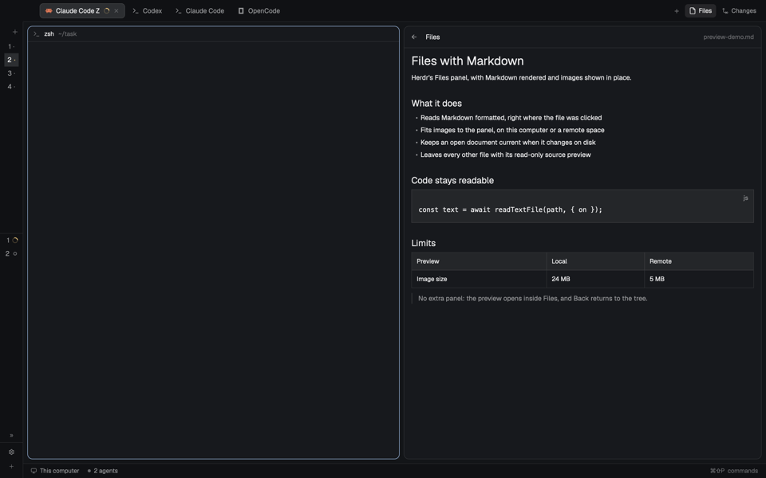

# Files with Markdown

Herdr's Files panel, with Markdown rendered and images shown in place, on this
computer or a remote space.

## What you see

The Files panel keeps its shipped look: a card with a 10 px radius, a 1 px
`border` edge and the theme's `background`; a 42 px header with a back arrow,
the title *Files* and the current folder or file name on the right; a tree of
28 px rows with folder and file icons, 7 px row corners, and a vertical
scrollbar when it overflows.

Clicking a Markdown file replaces the tree with its rendered text: 13 px UI
type, 14 px side padding and 10 px top and bottom padding, selectable, with a
vertical scrollbar. Clicking an image replaces the tree with the image fitted
inside a 10 px padded area, centered, never larger than the panel. Every other
file keeps the shipped read-only source preview.

The back arrow returns to the tree with every expanded folder preserved. The
header shows the open file's name in 12 px `dim` while a preview is showing.

## How it behaves

- Markdown means `.md`, `.mdx` or `.markdown`, case-insensitive. A leading YAML
  frontmatter block is hidden from the rendered view; the file on disk is never
  changed.
- Images means `.png`, `.jpg`, `.jpeg`, `.gif`, `.webp`, `.bmp`, `.ico`,
  `.avif` or `.svg`, case-insensitive.
- Clicking a file opens it; clicking a folder expands or collapses it. Rows
  sort folders first, then names. Every existing Files behavior stays: the
  focused pane's folder, remote machine roots, the 500-entry-per-folder and
  5,000-entry-total limits, Git status marks (A, M, D, U), and error messages.
- An open Markdown file or image reloads when that file (or the whole root)
  changes on this computer. A remote folder only refreshes its tree on the
  10-second timer; clicking the file again reloads it.
- Preview errors are explicit and replace only the preview: *This file is no
  longer available*, *Binary file · no text preview*, *Cannot preview this
  file (binary, too large, or unreadable)*, *Image too large to preview*,
  *Cannot preview this image*.
- Right-clicking a Markdown file opens Markdown Browser's two-item menu
  (*Preview in new pane*, *Open in Default app*) when that mod is installed.
  Without it, a notification says how to add it; nothing else changes.
- Text previews stop at 400,000 characters and say *… (file truncated)*. The
  host's `readTextFile` additionally caps a read at 1 MiB.

### Image limits and cache

`image()` resolves only paths inside the app home, so every image is copied to
`appHome()/files-preview/` before it is drawn. That folder is cleared whenever
the mod starts. Each source path gets a stable hash prefix; when it is shown
again its previous copy is removed. The prefix includes the machine name, so
the same absolute path on two machines cannot collide.

- This computer: `fs.readFile`, maximum 24 MB.
- Another machine: `exec(..., { on })`, maximum 5 MB of source bytes. The
  source is checked first with `wc -c` so an oversized file is not transferred.
  The cap leaves room for base64's one-third expansion and line breaks under
  `exec`'s 8 MiB output limit.

## Built from

Start from Herdr App 0.1.13's shipped `files` mod. Clone it; never edit the
shipped folder. The implementation here is that clone plus the changes below.

- `mods/files-markdown/mod.json` keeps `"place": "none"` and records
  `"cloned_from": { "name": "files", "version": "0.1.13" }`. The mod is shown
  only where a layout block points at it.
- Imports from `gpui-kit`: `View`, `div`, `svg`, `image`. From `gpui-base`:
  `v_flex`, `h_flex`, `Editor`, `EditorState`, `TextView`. From `herdr`:
  `spaces`, `panes`, `focused`, `exec`, `readTextFile`, `watchFolder`,
  `theme`, `settings`, `window`, `openOverlay`, `notify`, `appHome`.
  `fs/promises` supplies the local image read and the cache files; `Buffer`
  comes from `buffer`.
- Rendering Markdown: in `show()`, when the path matches the Markdown pattern,
  read it with `readTextFile(path, { on })`, strip frontmatter with
  `text.replace(/^---\r?\n[\s\S]*?\r?\n---\r?\n/, "")`, store the text, and
  render `TextView.markdown(\`files-md-${file}\`, prose).scrollable(true)
  .selectable(true).size_full()` in the preview branch. Do not build an
  `EditorState` for Markdown.
- Rendering images: branch to `showImage()` before any text read. Copy the
  bytes into `appHome()/files-preview/` and set `imagePath` to the relative
  `files-preview/<hash>-<time><ext>` path; render
  `image(imagePath).max_w_full().max_h_full()` inside a centered flex area.
- Local image: `fs.readFile(\`${root}/${path}\`)`, 24 MB cap.
- Remote image: `exec("wc", ["-c", full], { on })` for the precheck;
  `exec("sh", ["-c", 'base64 < "$1"', "image", full], { on })` to read it
  (macOS and Linux `base64` disagree about positional file arguments, so the
  file arrives on stdin); if that fails, `exec("powershell", ["-NoProfile",
  "-Command", "[Convert]::ToBase64String([IO.File]::ReadAllBytes(<literal>))"],
  { on })` for Windows. Decode with `Buffer.from(stdout.replace(/\s+/g, ""),
  "base64")`.
- Stale results: every `showImage()` call increments `imageRequest`; after each
  await, drop the result unless the request and `this.file` still match.
- Refresh: keep the shipped `watchFolder` loop. On a change, refresh the tree
  and, if the open path is Markdown or an image and either it or the root
  changed, call `show(file, cx)` again. The shipped 10-second timer stays.
- Right-click: on a Markdown row, `cx.stop_propagation()` and
  `openOverlay({ mod: "markdown-browser", kind: "popup", width: 220,
  height: 12 + 32 * 2, props: { file: \`${root}/${path}\`, on } })`. Detect the
  companion first with
  `fs.access(\`${appHome()}/mods/markdown-browser/mod.json\`)`; when it is
  missing, call `notify({ title: "Markdown Browser is not installed", body:
  "Add herdr.dev/mods/ohneda/herdr-markdown-browser for this menu.", level:
  "info" })`.
- Preview branch order: error text, then a ready image, then ready Markdown
  text, then the shipped `Editor` for other files, then *Loading file…*.
  Render 13 px Markdown in `px(14).py(10)`; render images in
  `p(10)` with centered content.

### Programs it runs

On this computer: `sh` for the folder listing (PowerShell on Windows), and
`git` for status marks; the folder watch is native to Herdr. On a remote space:
`git`, the shipped folder lister through `sh`, `wc` and `base64`, with
PowerShell as the Windows fallback. `notify` draws through the shipped `toast`
mod. The mod never reaches the network on its own.

## Install

There is no `layouts/` folder in this repository, and the mod needs no keys.

1. Copy `mods/files-markdown/` into `~/.config/herdr-app/mods/`. If that name
   is already taken, rename the folder, its `mods/<name>/` asset paths, and the
   layout's `content.mod` to match. Never overwrite a mod you did not write.
2. Point the active layout's Files block at it. If the layout is one of
   Herdr's shipped layouts, clone it first (`herdr-app do layout.clone --name
   main --as main-files-markdown`, or the current layout's name) and switch to
   the clone. Back up the layout file, then change the block whose
   `content.mod` is `"files"` to `"files-markdown"`. Keep its `id`, `size`,
   `min`, `max`, stack placement and `active` child exactly as they were.
3. `herdr-app check ~/.config/herdr-app/mods/files-markdown`
4. `herdr-app do layout.switch --name <the layout you edited>`
5. Open Files from the top bar and click a `.md` file or an image.

To remove it, point the block back at `files` (or switch to a layout that
already does), then delete the mod folder; no other file was changed.

## Watch out

- This is a snapshot of 0.1.13's Files mod. If the shipped Files code changes,
  re-clone the current `files` and re-apply the changes above instead of
  hand-merging; do not edit Herdr's folder.
- `image()` reads only the app home. Reading the source straight from the
  project folder silently fails; always copy into `files-preview/` first.
- `exec` stops at 8 MiB of output. A remote image larger than about 5 MB of
  source bytes will not fit after base64 encoding; keep the precheck and the
  cap.
- Base64 output differs by platform: use stdin (`sh -c 'base64 < "$1"'`) on
  Unix, and the PowerShell `[IO.File]::ReadAllBytes` form on Windows.
- A remote preview does not live-refresh: the shipped watch is local-only.
  Clicking the file again reloads it.
- The image cache lives under the app home and is cleared on every mod start;
  a crash can leave one run's files behind until the next start.
- The right-click menu belongs to Markdown Browser. Publishing this mod does
  not include that mod; the menu is simply absent (with a notification) until
  the person installs it.
- The top bar's *Files* button and its stack are part of the layout, not this
  mod. Without the layout edit in **Install**, the mod loads but is never
  shown.

## Done when

- `herdr-app check mods/files-markdown` passes.
- In a layout whose Files block points at `files-markdown`, clicking a `.md`,
  `.mdx` or `.markdown` file shows formatted text with headings, lists, code
  and tables, and no frontmatter.
- An image click shows the image fitted inside the panel; Back returns to the
  tree with the same folders expanded.
- A local image above 24 MB shows *Image too large to preview* instead of
  loading; a remote image above 5 MB does the same without transferring it.
- A remote-space image renders through the base64 path on a Unix host, and
  through PowerShell on Windows.
- Editing an open local Markdown file or image updates the preview; a remote
  one updates after clicking it again.
- With Markdown Browser absent, right-clicking a Markdown row posts the
  notification and changes nothing else; with it present, the two-item menu
  opens at the pointer.
- Other file types still show the shipped read-only source preview, and the
  tree still lists a remote space and marks Git changes.
